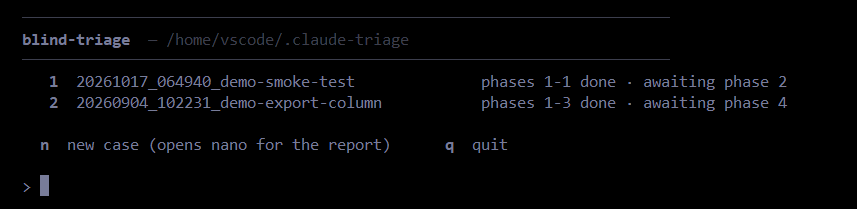

# blind-triage

**A phased, context-cleared protocol that re-diagnoses and fixes bugs that already come with an answer attached.**

Developed against a known-answer case: a bug whose cause was already established, and which
single-session attempts kept getting wrong. The protocol was iterated until a trial reached that
answer, and it kept changing shape for a good while after that.

## How it works

A five-stage procedure that strips the proposed cause out of a bug report, then walks Claude through
the investigation in isolated stages so that evidence gets gathered before any explanation exists.

0. **Quarantine** — restate the report as the observed symptom only; delete the cause and the file
   list, and show the human what was deleted.
1. **Evidence** — run the measurements and report the output. Naming a cause is forbidden.
2. **Accounts** — produce 2–3 rival explanations and, for each, the one test that would disprove it.
   Ranking them is forbidden.
3. **Discriminate** — run those tests, on data taken from the real code path. Report which
   explanations died and which survived.
4. **Fix** — order every dropped clue from earliest to latest and fix the earliest one that alone
   would have prevented the symptom.

Two things carry the weight:

- **Context isolation.** Each stage starts in a wiped context and receives exactly one artifact — the
  previous stage's packet, not its reasoning. In the failed trials, once a hypothesis existed in the
  conversation, everything that followed defended it instead of testing it.
- **Hard stops, not advice.** Naming a cause in Phase 1 is forbidden outright, not discouraged. Every
  packet carries an `ORPHAN OBSERVATIONS` field that must read `NONE` explicitly — a blank is
  visible, a silent omission isn't. No fix is accepted until the killing question is answered:
  *what single result would have proved this wrong, and did you run it?*

## What's built

The driver, [`scripts/triage/blind-triage.sh`](scripts/triage/blind-triage.sh), runs each phase as a
separate headless `claude -p` process, with two Python helpers for live output and recovery. Some
rules are enforced by that machinery. The rest are instructions in the prompt, and the stop line
after each phase is where a human checks them.

**Enforced by the driver**

- **One process per phase.** Each phase starts with no memory of the last and receives one file: the
  previous phase's packet.
- **Phase 0 runs alone.** It is the only phase that sees the original report.
- **The report is sealed by the filesystem.** The case directory lives outside the repo
  (`~/.claude-triage` by default), and permission rules stop later phases from reading the original
  report, the logs and the prompts.
- **Git stays yours.** The common git write commands (`commit`, `push`, `reset`, …) are on every
  phase's deny list; committing is left to you.
- **Plan first.** Phase 4 writes a plan by default, with the Edit tool removed. `--fix` authors an
  approved plan as a separate run.
- **Recoverable phases.** Each packet is streamed to disk as it is written, so a phase that dies
  mid-run can be resumed (`--resume N`) rather than rerun from scratch.

**Asked for in the prompt, checked by you at each stop line**

- no cause named in Phase 1, and no ranking of the rival accounts in Phase 2;
- the `ORPHAN OBSERVATIONS` field, filled in explicitly;
- the killing question, answered before a fix.

## What it looks like

Running the driver with no arguments opens a menu of cases, each showing how many phases are done:



## Quickstart

**Needs:** `bash` **4.0 or newer**, `python3`, and the `claude` CLI on your PATH. *(macOS ships bash
3.2, which cannot parse the driver — install a current bash first.)*

```bash
git clone <this repo> /tmp/blind-triage

mkdir -p your-project/.claude/skills
cp -r /tmp/blind-triage/scripts/triage your-project/scripts/
cp -r /tmp/blind-triage/.claude/skills/blind-triage your-project/.claude/skills/
cp -r /tmp/blind-triage/.claude/skills/fix-run your-project/.claude/skills/

cd your-project
scripts/triage/blind-triage.sh -f your-report.txt   # start a case from any bug report
scripts/triage/blind-triage.sh                      # …or run bare for the case menu
```

Also paste [`RULES_FOR_CLAUDE_MD.md`](RULES_FOR_CLAUDE_MD.md) into your project's `CLAUDE.md` — the
skill defers to it.

Optionally, copy `.claude/hooks/py_syntax_check.py` and `.claude/settings.json` as well; together they
run a syntax check on each Python file Claude edits. The protocol does not depend on them.

It will blind your report, then drive phases 0–4 as one process per phase. Then it will stop: the
evidence phase measures your codebase with boundary-audit instruments, and **those are yours to
write** — the protocol owns the sequencing, not the probes. What to supply, the main CLI flags, and
chat-mode usage: [`docs/USAGE.md`](docs/USAGE.md).

**Or run nothing at all.** [`examples/`](examples/) holds a real bug report beside the real blinded
packet Phase 0 produced from it — the fastest way to see what this does, and it costs about a minute.
The protocol itself is [`.claude/skills/blind-triage/SKILL.md`](.claude/skills/blind-triage/SKILL.md).

## Edge cases & observations

- **It has been tested against one known-answer case** — the one it was tuned on.
- **It buys sequencing, not insight.** It stops evidence and hypothesis from collapsing into one
  breath. It does not make anyone smarter about your system.
- **Phase 0 blinding happens after the title has been read**, so it can under-blind. That's why the
  packet lists what was deleted — so a human can object. Quarantine, not amnesia.
- **Every stop line can hold and the answer still be missed**, and re-pasting the original report at
  a later phase re-poisons it — once blinded, sealed.
- **It costs real money, per phase** — each phase is its own model session, which is the price of the
  isolation. Details: [`docs/USAGE.md`](docs/USAGE.md).

## What's in here

```
README.md                                  this file
docs/USAGE.md                              full CLI reference, chat mode, what to supply
examples/README.md                         a real Phase 0, annotated — start here
examples/01-report.txt                     the bug report as submitted
examples/02-phase0-packet.md               everything Phase 1 was allowed to see
examples/instruments/                      the four boundary audits, as reference copies
RULES_FOR_CLAUDE_MD.md                     the rules SKILL.md defers to: paste into your CLAUDE.md
.claude/skills/blind-triage/SKILL.md       the protocol itself
.claude/skills/fix-run/SKILL.md            the map SKILL.md cites: which instrument, which boundary
.claude/hooks/py_syntax_check.py           optional: syntax-checks each Python file Claude edits
.claude/settings.json                      registers that hook (its only entry)
scripts/triage/blind-triage.sh             the headless driver
scripts/triage/fix-run.sh                  the other half: one broken run, no phases
scripts/triage/_stream.py                  live phase output + on-disk packet capture
scripts/triage/extract_thoughts_v2.py      rebuilds a phase that died mid-run
```

The skill is the interesting file and GitHub hides dotted directories, so here it is directly:
[`.claude/skills/blind-triage/SKILL.md`](.claude/skills/blind-triage/SKILL.md).

**Effort was made to keep almost everything here as was in the run:** shell drivers, all three Python
helpers, all four audits, and both example artifacts. **Two files are excerpts** — `blind-triage/SKILL.md`
and `fix-run/SKILL.md` — and each marks its own cuts in place, stating what was removed and why.

## Known limitations

- Pressing `[b]` (bounce) at a phase stop line re-runs the phase without your objection. Use `[e]` to
  edit the packet directly instead.
